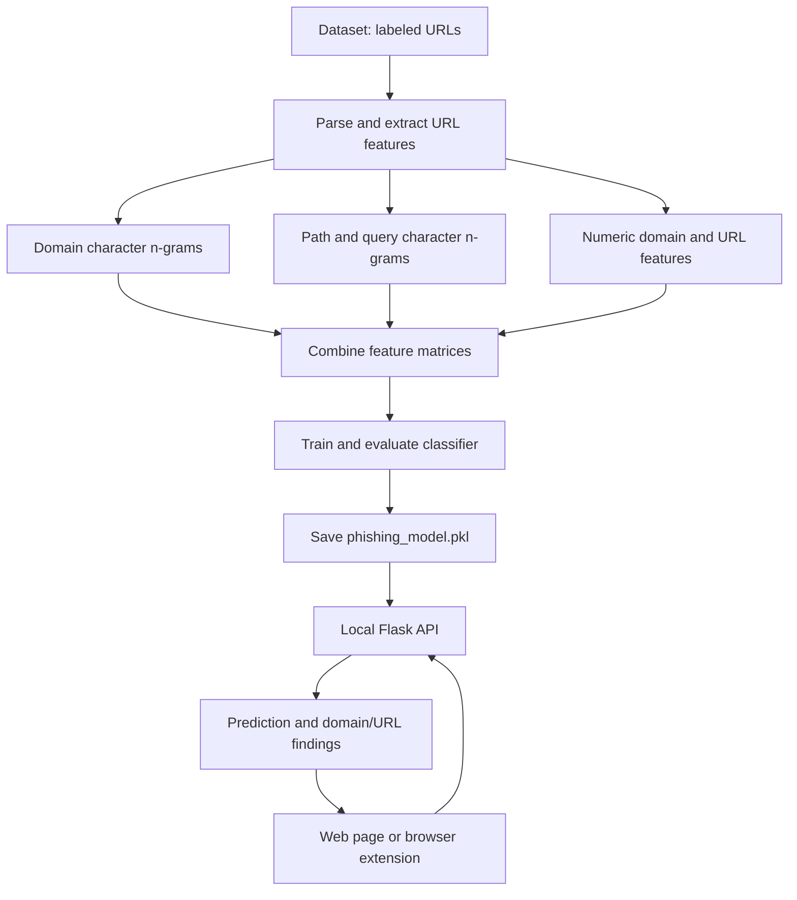

# PhishGuard: Domain-Aware Phishing URL Detector

PhishGuard is an educational cybersecurity project that estimates whether a URL resembles phishing examples. It combines hostname analysis, URL structure analysis, and character-pattern machine learning in a local Python backend. It also includes a Manifest V3 browser extension for Brave and Google Chrome.

> **Important:** PhishGuard is a student prototype, not an antivirus product or a browser safe-browsing replacement. A warning is not proof that a URL is malicious, and a low score is not proof that it is safe. The system does not inspect page content or query live domain reputation services.

## Contents

- [Features](#features)
- [How it works](#how-it-works)
- [Project structure](#project-structure)
- [Requirements](#requirements)
- [Windows setup](#windows-setup)
- [Run the web interface](#run-the-web-interface)
- [Install the browser extension](#install-the-browser-extension)
- [API reference](#api-reference)
- [Tests and model evaluation](#tests-and-model-evaluation)
- [Dataset and generated model](#dataset-and-generated-model)
- [Limitations and responsible use](#limitations-and-responsible-use)
- [Attribution and licensing](#attribution-and-licensing)
- [Troubleshooting](#troubleshooting)

## Features

- **Domain analysis:** extracts the hostname, registered domain, public suffix, subdomain depth, IP-address indicators, IDN/punycode indicators, hostname character statistics, and selected suspicious wording and brand-token patterns.
- **Hostname character patterns:** uses character n-grams to learn spelling fragments from hostname examples, which can help identify lookalike patterns that counts alone cannot express.
- **Path and query patterns:** analyzes path and query character n-grams plus URL structure signals such as path depth, query parameters, percent encoding, user-information syntax, non-standard ports, and suspicious file extensions.
- **Combined classifier:** combines numeric features with sparse character-pattern features using a scikit-learn classifier.
- **Domain-disjoint evaluation:** groups examples by registered domain when creating the evaluation split, helping reduce the leakage that can occur when URLs from the same domain appear in both training and testing.
- **Explanatory results:** presents domain and URL indicators separately and shows an estimated phishing score.
- **Local operation:** the model and Flask API run on the user's computer. No remote URL-scanning API is configured by default.
- **Browser extension:** lets a user analyze the URL of the active tab or paste another URL into a popup.

## How it works



At prediction time, the frontend sends the URL to the Flask API. The backend validates and parses the URL, constructs the same feature representation used for training, and returns the model score plus separate domain and URL observations.

A small, explicitly limited rule recognizes the exact HTTPS homepage of selected well-known domains. This is not a general whitelist for their subpages. When a known domain's URL pattern conflicts with the model, the app can show a mixed-signal review result rather than implying that the destination is automatically safe.

For more detail, see [`docs/ARCHITECTURE.md`](docs/ARCHITECTURE.md) and [`docs/DATASET_AND_EVALUATION.md`](docs/DATASET_AND_EVALUATION.md).

## Project structure

```text
PhishingDetectionSystem_DomainAware/
├── app.py                         # Flask API on 127.0.0.1:5000
├── train_model.py                 # training and domain-disjoint evaluation
├── model_pipeline.py              # shared feature-matrix creation
├── url_features.py                # URL parsing and feature extraction
├── public_suffix_list.dat          # offline public-suffix rules
├── index.html                     # standalone web interface and user guide
├── requirements.txt               # Python dependencies
├── test_url_features.py           # URL and domain feature tests
├── test_model_pipeline.py         # hybrid-pipeline test
├── THIRD_PARTY_NOTICES.md         # third-party data attribution
├── browser_extension/             # unpacked Manifest V3 browser extension
├── docs/                           # setup, API, architecture, and evaluation docs
├── phishing_dataset.csv           # local training data, excluded from Git by default
└── phishing_model.pkl             # generated model, excluded from Git
```

The dataset and model file are deliberately ignored by Git in this repository template. See [Dataset and generated model](#dataset-and-generated-model) before pushing to a public repository.

## Requirements

- Windows 10 or 11 instructions are provided below.
- Python 3.12 is the recommended environment for this project.
- Google Chrome or Brave for the browser extension.
- Git for publishing or versioning the source code.
- The authorized training CSV is required only when training or retraining the model.

The browser extension does not require Node.js, npm, a frontend framework, or a separate web server. It does require the local Flask backend to be running.

## Windows setup

### 1. Open PowerShell in the project folder

Navigate into the folder containing `app.py`, `train_model.py`, and `requirements.txt`. Do not run these commands from `C:\Windows\System32` or a parent folder that does not contain the project.

### 2. Confirm Python

```powershell
py -3.12 --version
```

### 3. Create a virtual environment

```powershell
py -3.12 -m venv .venv
```

### 4. Install dependencies

```powershell
.\.venv\Scripts\python.exe -m pip install --upgrade pip
.\.venv\Scripts\python.exe -m pip install -r requirements.txt
```

### 5. Add the authorized dataset

Training requires `phishing_dataset.csv` in the project root. Its required columns are:

```csv
url,label
https://example.com,legitimate
http://suspicious.example/path,phishing
```

The accepted labels are `legitimate` and `phishing`. This repository does not currently document the original source or redistribution license for the supplied dataset, so the raw CSV is excluded from Git by default. Obtain the dataset from its original source and follow its license or redistribution terms. See [`docs/DATASET_AND_EVALUATION.md`](docs/DATASET_AND_EVALUATION.md).

### 6. Run the tests

```powershell
.\.venv\Scripts\python.exe -m unittest discover -v
```

### 7. Train the model

```powershell
.\.venv\Scripts\python.exe train_model.py
```

Training may take several minutes, depending on hardware and dataset size. The script evaluates the classifier on held-out registered domains and saves `phishing_model.pkl` in the project root. Keep the terminal open until it reports that the model was saved.

**Retrain this version before the first run.** It uses a hybrid character n-gram and numeric feature model. Do not reuse a model generated by an older version of the project.

## Run the web interface

Open two PowerShell windows in the project root.

**Terminal 1, start the backend:**

```powershell
.\.venv\Scripts\python.exe app.py
```

The API listens on `http://127.0.0.1:5000`. Check `http://127.0.0.1:5000/health` to see whether the model loaded successfully.

**Terminal 2, serve the frontend:**

```powershell
py -3.12 -m http.server 8000
```

Open `http://localhost:8000/index.html` in Chrome or Brave. The static web server must be started from the folder containing `index.html`.

For everyday use, the trained model does not need to be retrained again unless the dataset, feature extraction logic, or training configuration changes.

## Install the browser extension

The extension is an unpacked Manifest V3 extension. It scans manually when the user opens the popup and clicks Analyze URL. It can use the active tab URL or a manually pasted URL.

1. Start the backend using the command in [Run the web interface](#run-the-web-interface), Terminal 1. The frontend server on port 8000 is **not** needed for the extension.
2. Open `brave://extensions` in Brave or `chrome://extensions` in Chrome.
3. Enable **Developer mode**.
4. Select **Load unpacked**.
5. Choose the repository's `browser_extension` directory, the one containing `manifest.json`.
6. Pin PhishGuard from the browser's extensions menu.
7. Open a normal website, click the PhishGuard icon, and analyze the current tab or paste another URL.

The extension calls the API at `http://127.0.0.1:5000`. Keep the backend running while using it. For the complete extension guide, see [`docs/BROWSER_EXTENSION.md`](docs/BROWSER_EXTENSION.md) and [`browser_extension/README.md`](browser_extension/README.md).

## API reference

### `GET /health`

Reports whether the model is loaded.

Example:

```json
{
  "status": "ok",
  "model_loaded": true,
  "model_version": 3,
  "model_name": "Hybrid domain and URL character n-gram classifier",
  "error": null
}
```

The exact model name and version are returned by the running backend. If the model is missing or outdated, the endpoint returns HTTP `503` and an error message.

### `POST /predict`

Request body:

```json
{
  "url": "https://example.com/account"
}
```

The response includes the normalized input URL, final verdict, raw model verdict, estimated phishing score, result explanation, domain analysis, URL structure analysis, and limitations. The main fields include:

- `is_phishing`: final application verdict after the narrow homepage/context rule.
- `model_is_phishing`: raw classifier label before that rule.
- `phishing_score`: model-estimated score for the phishing class, from 0 to 100.
- `result_label`: user-facing verdict.
- `domain_analysis`: hostname and registered-domain observations.
- `url_analysis`: path, query, encoding, and URL-structure observations.
- `explanation`: a plain-language explanation and caveat.

`phishing_score` is not a guarantee and is not necessarily a calibrated probability of real-world maliciousness. A model score alone should not be interpreted as a verdict from a live threat database. See [`docs/API.md`](docs/API.md) for examples and error responses.

## Tests and model evaluation

Run all unit tests with:

```powershell
.\.venv\Scripts\python.exe -m unittest discover -v
```

The test suite checks domain parsing, public suffix handling, hostname and URL feature separation, URL validation, the narrow homepage recognition rule, and construction of the hybrid feature matrix.

During training, the script prints accuracy, precision, recall, F1 score, false positive rate, confusion matrix, and classification report for a held-out domain split. Treat those as results on this dataset and split, not proof of real-world performance. The full model must be trained locally to obtain the metrics for that run; do not copy unverified metrics into a presentation.

## Dataset and generated model

`phishing_dataset.csv` is needed for training and must have `url` and `label` columns. The source and redistribution terms for the CSV supplied with the original project have not been established in this repository. For that reason:

- `phishing_dataset.csv` is ignored by `.gitignore` and is not intended to be pushed to a public GitHub repository until its source and license have been verified.
- `phishing_model.pkl` is generated locally and ignored by Git. Recreate it by running `train_model.py` after obtaining the authorized dataset.
- A person cloning this repository must obtain an authorized dataset and place it at the project root before they can train the model.
- Do not force-add the CSV merely to make the repository look complete. First verify the dataset's source, terms, and any required attribution.

If you have confirmed the dataset can be redistributed, you may remove the dataset entry from `.gitignore`, document the origin and license in the README, and add the file to the repository. GitHub enforces a 100 MB limit for an individual Git file, but license and provenance should be checked before size is considered. See GitHub's [repository limits](https://docs.github.com/en/repositories/creating-and-managing-repositories/repository-limits).

## Limitations and responsible use

- URL and domain text can indicate suspicious patterns, but attackers can use clean-looking domains and URLs.
- The model is only as reliable as the labels, coverage, recency, and distribution of its training data.
- The application does not query DNS, inspect certificate history, retrieve domain registration dates, follow redirects, inspect HTML/JavaScript, or perform a live malware scan.
- It does not automatically block or prevent navigation. The extension is a manual checker.
- Recognizing a well-known root homepage does not make its subpages or user-hosted content safe.
- The score is a model estimate, not a confirmed real-world probability.
- Do not enter secrets, passwords, session tokens, or private internal URLs into a public demo.

Use additional trusted security controls and threat intelligence for real-world protection. Do not rely on this prototype as the only security measure.

## Attribution and licensing

The bundled `public_suffix_list.dat` is a snapshot of the Public Suffix List. Its source and licensing details are documented in [`THIRD_PARTY_NOTICES.md`](THIRD_PARTY_NOTICES.md). This snapshot may become stale and should be refreshed from the upstream project when appropriate.

No root-level license has been selected for this project's original code. Before presenting the repository as open source, select a license for the code you are authorized to license and separately verify the data and third-party notices. A public GitHub repository does not automatically grant broad reuse rights; see [GitHub's licensing guidance](https://docs.github.com/en/repositories/managing-your-repositorys-settings-and-features/customizing-your-repository/licensing-a-repository).

## Troubleshooting

| Issue | What to check |
|---|---|
| `requirements.txt` not found | Navigate to the directory containing the project files before running pip. |
| `train_model.py` not found | Make sure PowerShell is in the project root. Use `dir` to check. |
| Dataset not found | Obtain the authorized CSV and place `phishing_dataset.csv` in the project root. |
| `phishing_model.pkl` missing | Run `train_model.py` and wait for training to complete. |
| Old or incompatible model | Retrain with the current code, then restart `app.py`. |
| Website returns 404 | Start `http.server` from the folder containing `index.html`. |
| Extension cannot connect | Keep `app.py` running and confirm `http://127.0.0.1:5000/health` reports `model_loaded: true`. |
| Port 5000 or 8000 is occupied | Stop the other process using that port, or adjust the API and extension configuration consistently. |
| False positive or false negative | Review the domain and URL indicators, inspect data labels, and evaluate on new domains rather than adding broad allowlists. |

## Further documentation

- [Windows setup and runbook](docs/SETUP_WINDOWS.md)
- [Publish to GitHub](docs/PUBLISH_TO_GITHUB.md)
- [System architecture and model overview](docs/ARCHITECTURE.md)
- [API reference and sample responses](docs/API.md)
- [Browser extension installation](docs/BROWSER_EXTENSION.md)
- [Dataset, evaluation, and reproducibility](docs/DATASET_AND_EVALUATION.md)
