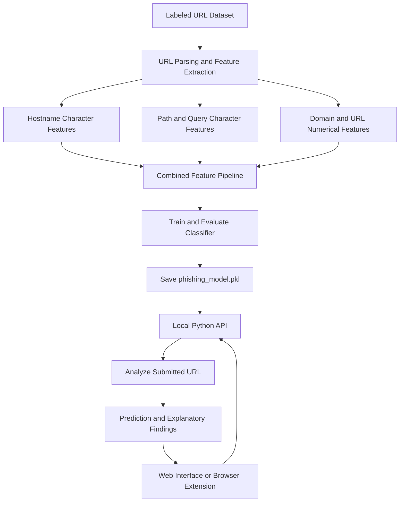

# Machine Learning Based Phishing URL Detection System for Web Browser

A machine learning based URL detection system that analyzes domain characteristics, URL structure, and character patterns to estimate whether a submitted URL resembles a phishing URL. The system includes a Python backend, a web interface, and a Manifest V3 browser extension compatible with Google Chrome and Brave.

> **Important:** This system is a prototype for phishing URL detection. It is not an antivirus product or a replacement for browser safe browsing features. A warning does not prove that a URL is malicious, and a low phishing score does not guarantee that a URL is safe.

## Table of Contents

1. [Overview](#overview)
2. [Features](#features)
3. [How the System Works](#how-the-system-works)
4. [Project Structure](#project-structure)
5. [Requirements](#requirements)
6. [Installation and Setup](#installation-and-setup)
7. [Running the System](#running-the-system)
8. [Installing the Browser Extension](#installing-the-browser-extension)
9. [Using the System](#using-the-system)
10. [API Reference](#api-reference)
11. [Testing and Model Evaluation](#testing-and-model-evaluation)
12. [Dataset and Model Training](#dataset-and-model-training)
13. [Limitations](#limitations)
14. [Troubleshooting](#troubleshooting)
15. [Additional Documentation](#additional-documentation)

## Overview

The Machine Learning Based Phishing URL Detection System for Web Browser analyzes submitted URLs using a combination of domain analysis, URL structure analysis, and machine learning.

Unlike a basic detector that relies mainly on URL length and special character counts, this system extracts multiple features from the hostname, domain, subdomain, path, and query parameters. It also uses character n-grams to learn patterns in URL text from labeled training examples.

The system provides a phishing classification result, an estimated phishing score, and observations that help explain the characteristics identified during analysis.

The application runs locally on the user's computer. The browser extension communicates with the local Python backend to analyze URLs.

## Features

- **Domain analysis:** Examines hostname structure, registered domain, public suffix, subdomain depth, IP address usage, internationalized domain name indicators, and selected suspicious wording patterns.
- **Character pattern analysis:** Uses character n-grams to learn patterns from hostnames, URL paths, and query strings.
- **URL structure analysis:** Examines URL length, path depth, query parameters, percent encoded characters, user information syntax, nonstandard ports, and selected suspicious file extensions.
- **Combined machine learning model:** Combines numerical URL features with character based features through a scikit-learn pipeline.
- **Domain aware evaluation:** Uses registered domain groups when splitting data for evaluation to help reduce the risk of similar URLs appearing in both training and test sets.
- **Explainable results:** Displays the classification result, estimated phishing score, and separate domain and URL observations.
- **Local backend:** Runs the prediction API on the user's computer without requiring a remote URL scanning API by default.
- **Web interface:** Allows users to submit URLs through a browser based interface.
- **Browser extension:** Allows users to analyze the active tab URL or manually enter another URL through a browser popup.
- **Automated tests:** Includes tests for URL feature extraction, domain handling, and construction of the model's feature pipeline.

## How the System Works

The system has two main workflows: model training and URL prediction.

### 1. Model Training

A labeled dataset containing legitimate and phishing URLs is processed to extract the features used by the machine learning model.

The system combines numerical features with character n-gram features and trains a classifier. It then evaluates the model using a held out domain split and saves the trained model as `phishing_model.pkl`.

### 2. URL Prediction

When a user submits a URL, the backend parses it and extracts the same types of features used during training. The trained model then produces a prediction and an estimated phishing score.

The application returns the result together with domain and URL observations for display in the web interface or browser extension.



### Features Analyzed by the System

| Feature category | Examples |
|---|---|
| Domain structure | Hostname, registered domain, public suffix, subdomain depth |
| Hostname characteristics | IP address indicators, punycode, suspicious words, character patterns |
| Numerical URL features | URL length, special character counts, query parameter counts |
| Path characteristics | Path depth, suspicious file extensions, character sequences |
| Query characteristics | Query parameters, encoded characters, suspicious URL patterns |
| Combined model features | Numerical features and sparse character n-gram representations |

The system also includes a limited rule for recognizing the exact HTTPS homepage of selected well known domains. This rule is not a general whitelist for their subpages or hosted content. Depending on the implementation's decision logic, conflicting model and domain signals may result in a review oriented verdict.

For a detailed explanation, see [`docs/ARCHITECTURE.md`](docs/ARCHITECTURE.md) and [`docs/DATASET_AND_EVALUATION.md`](docs/DATASET_AND_EVALUATION.md).

## Project Structure

```text
machine_learning_based_phishing_URL_detection_system_for_web_browser/
├── app.py
├── train_model.py
├── model_pipeline.py
├── url_features.py
├── public_suffix_list.dat
├── index.html
├── requirements.txt
├── test_url_features.py
├── test_model_pipeline.py
├── browser_extension/
│   ├── manifest.json
│   ├── popup.html
│   ├── popup.css
│   ├── popup.js
│   ├── icons/
│   └── README.md
├── docs/
│   ├── SETUP_WINDOWS.md
│   ├── ARCHITECTURE.md
│   ├── API.md
│   ├── BROWSER_EXTENSION.md
│   ├── DATASET_AND_EVALUATION.md
│   ├── PRESENTATION_GUIDE.md
│   └── PUBLISH_TO_GITHUB.md
├── phishing_dataset.csv
└── phishing_model.pkl
```

The dataset and trained model shown in the structure may be stored locally rather than included in the public repository. The dataset is needed for training, while the generated model is needed for prediction.

## Requirements

- Windows 10 or Windows 11
- Python 3.12
- Google Chrome or Brave, if using the browser extension
- Git, if cloning or updating the repository
- An authorized training dataset, if training or retraining the model

The browser extension does not require Node.js, npm, or a frontend framework. It does require the local Python backend to be running.

## Installation and Setup

### 1. Download the project

Clone the repository:

```powershell
git clone https://github.com/geoffabramvicera/machine_learning_based_phishing_URL_detection_system_for_web_browser.git
```

Enter the project folder:

```powershell
cd machine_learning_based_phishing_URL_detection_system_for_web_browser
```

Alternatively, download the repository as a ZIP file from GitHub and extract it.

### 2. Verify Python

```powershell
py -3.12 --version
```

The command should display Python 3.12.x.

### 3. Create a virtual environment

Run this command from the project root, the directory containing `app.py` and `requirements.txt`.

```powershell
py -3.12 -m venv .venv
```

### 4. Install dependencies

```powershell
.\.venv\Scripts\python.exe -m pip install --upgrade pip
.\.venv\Scripts\python.exe -m pip install -r requirements.txt
```

### 5. Prepare the dataset

To train the model, place an authorized `phishing_dataset.csv` file in the project root.

The CSV must contain the following columns:

```csv
url,label
https://example.com,legitimate
http://suspicious.example/path,phishing
```

The accepted labels are `legitimate` and `phishing`. These example URLs illustrate the expected format and are not a recommended training dataset.

Obtain training data from a source whose license and redistribution terms permit your intended use. If you already have a trained model compatible with the current code, you may be able to run the application without retraining.

### 6. Run the tests

```powershell
.\.venv\Scripts\python.exe -m unittest discover -v
```

Review the output to determine whether the tests pass.

### 7. Train the model, if necessary

```powershell
.\.venv\Scripts\python.exe train_model.py
```

The script processes the dataset, trains and evaluates the classifier, and saves `phishing_model.pkl` in the project root.

Training may take several minutes, depending on dataset size and computer performance. Wait for the script to finish before starting the backend.

Use a model generated by the current version of the feature extraction and training code. A model generated by an incompatible older version may not load or produce valid predictions.

## Running the System

### 1. Start the backend

Open PowerShell in the project root and run:

```powershell
.\.venv\Scripts\python.exe app.py
```

Keep this terminal open while using the application.

The local API is expected to be available at:

`http://127.0.0.1:5000`

Check its health endpoint:

`http://127.0.0.1:5000/health`

A successful response should indicate that the model loaded correctly.

### 2. Open the web interface

Open a second PowerShell window in the same project root and run:

```powershell
py -3.12 -m http.server 8000
```

Open the following address in Chrome or Brave:

`http://localhost:8000/index.html`

The static web server must be started from the directory containing `index.html`.

The web interface and backend use separate ports. Keep both terminals running when using the standalone web interface.

### Everyday use

Once a compatible trained model exists, the model does not need to be retrained every time the system starts. Retraining is necessary when the dataset, feature extraction logic, or training configuration changes.

## Installing the Browser Extension

The project includes an unpacked Manifest V3 extension for Google Chrome and Brave.

### Installation steps

1. Start the Python backend using the instructions above.
2. Open `chrome://extensions` in Google Chrome or `brave://extensions` in Brave.
3. Enable **Developer mode**.
4. Click **Load unpacked**.
5. Select the project's `browser_extension` folder, which contains `manifest.json`.
6. Pin the extension using the browser's extensions menu.
7. Open the extension popup to begin analyzing URLs.

The extension communicates with the local backend at:

`http://127.0.0.1:5000`

The static web server on port 8000 is not required for the extension. The backend must remain running while the extension is in use.

See [`docs/BROWSER_EXTENSION.md`](docs/BROWSER_EXTENSION.md) and [`browser_extension/README.md`](browser_extension/README.md) for additional instructions.

## Using the System

### Through the web interface

1. Start the backend and web server.
2. Open `http://localhost:8000/index.html`.
3. Enter or paste a URL into the input field.
4. Click the URL analysis button.
5. Review the classification result, phishing score, and domain and URL observations.
6. Treat suspicious results as warnings that require further investigation.

### Through the browser extension

1. Start the backend.
2. Open a webpage or navigate to the URL you want to examine.
3. Click the extension icon.
4. Analyze the active tab URL or enter a URL manually, depending on the popup's available controls.
5. Review the returned result.

The extension is a manual checker. It does not automatically block navigation or replace the browser's built in security protections.

## API Reference

### `GET /health`

Checks whether the backend is running and whether the trained model is loaded.

Example response:

```json
{
  "status": "ok",
  "model_loaded": true,
  "model_version": 3,
  "model_name": "Hybrid domain and URL character n-gram classifier",
  "error": null
}
```

The exact model name and version depend on the running backend. If the model is missing or incompatible, the endpoint may report an error or return HTTP `503`.

### `POST /predict`

Submits a URL for analysis.

Example request:

```json
{
  "url": "https://example.com/account"
}
```

The response contains the prediction, estimated phishing score, and explanatory information. Main fields may include:

- `is_phishing`: final application verdict after the configured decision rules.
- `model_is_phishing`: raw classifier label before additional application rules.
- `phishing_score`: estimated score for the phishing class, from 0 to 100.
- `result_label`: user facing classification.
- `domain_analysis`: observations about the hostname and registered domain.
- `url_analysis`: observations about the path, query, encoding, and URL structure.
- `explanation`: explanatory text and relevant caveats.

The exact response fields depend on the implementation. See [`docs/API.md`](docs/API.md) for endpoint details, examples, and error responses.

The phishing score is not necessarily a calibrated probability of real world maliciousness. It is a model estimate based on the trained classifier, not confirmation from a live threat intelligence database.

## Testing and Model Evaluation

Run the unit tests with:

```powershell
.\.venv\Scripts\python.exe -m unittest discover -v
```

The tests cover URL feature extraction, domain parsing, URL validation, selected domain recognition behavior, and construction of the combined model feature matrix.

During training, the script reports classification metrics such as:

- Accuracy
- Precision
- Recall
- F1 score
- False positive rate
- Confusion matrix
- Classification report

The evaluation uses a held out domain split to help reduce leakage between training and testing examples from the same registered domain.

These metrics describe performance on the dataset and evaluation split used for that training run. They do not establish guaranteed performance on previously unseen real world phishing attacks.

Do not report unverified performance values in project documentation or presentations. Use the actual output from your training run.

## Dataset and Model Training

The training dataset must contain `url` and `label` columns. The training script extracts URL features, builds the combined feature representation, trains the classifier, and evaluates it.

The generated `phishing_model.pkl` file stores the trained pipeline used by the backend.

If the dataset is not distributed with the repository, users must obtain an authorized copy and place it in the project root before training. If the model file is also absent, training must be completed before predictions can be made.

Before publishing a dataset or a generated model, verify the source, license, redistribution conditions, and any applicable attribution requirements.

## Limitations

- URL and domain text can reveal suspicious patterns, but phishing URLs can also look legitimate.
- Model reliability depends on the quality, coverage, freshness, and labeling accuracy of the training dataset.
- The system does not automatically query DNS, inspect certificate history, retrieve domain registration dates, follow redirects, inspect webpage HTML or JavaScript, or perform a live malware scan.
- It does not automatically block malicious destinations.
- A recognized domain homepage does not make every subpage or user hosted resource safe.
- The phishing score is an estimate, not a confirmed real world probability.
- The system may produce false positives and false negatives.
- The public suffix list snapshot can become outdated and may require maintenance.

Use the system as an additional URL analysis tool rather than as the sole means of cybersecurity protection.

## Troubleshooting

| Problem | Suggested solution |
|---|---|
| `requirements.txt` not found | Navigate to the project root before installing dependencies. |
| `train_model.py` not found | Confirm that PowerShell is in the folder containing the training script. |
| Dataset not found | Place an authorized `phishing_dataset.csv` in the project root before training. |
| `phishing_model.pkl` missing | Train the model and wait for the process to finish. |
| Model fails to load | Retrain using the current code and restart the backend. |
| Web interface returns 404 | Start the static server from the folder containing `index.html`. |
| Extension cannot connect | Keep the backend running and check `http://127.0.0.1:5000/health`. |
| Port 5000 or 8000 is occupied | Stop the conflicting process or update the relevant configuration consistently. |
| A legitimate URL is flagged | Review the domain and URL findings and evaluate the model against additional labeled examples. |
| A phishing URL is marked safe | Treat the result cautiously and use additional trusted security tools. |

## Additional Documentation

- [Windows Setup Guide](docs/SETUP_WINDOWS.md)
- [System Architecture](docs/ARCHITECTURE.md)
- [API Documentation](docs/API.md)
- [Browser Extension Guide](docs/BROWSER_EXTENSION.md)
- [Dataset and Model Evaluation](docs/DATASET_AND_EVALUATION.md)
- [Presentation Guide](docs/PRESENTATION_GUIDE.md)
- [GitHub Publishing Guide](docs/PUBLISH_TO_GITHUB.md)
- [Browser Extension README](browser_extension/README.md)
